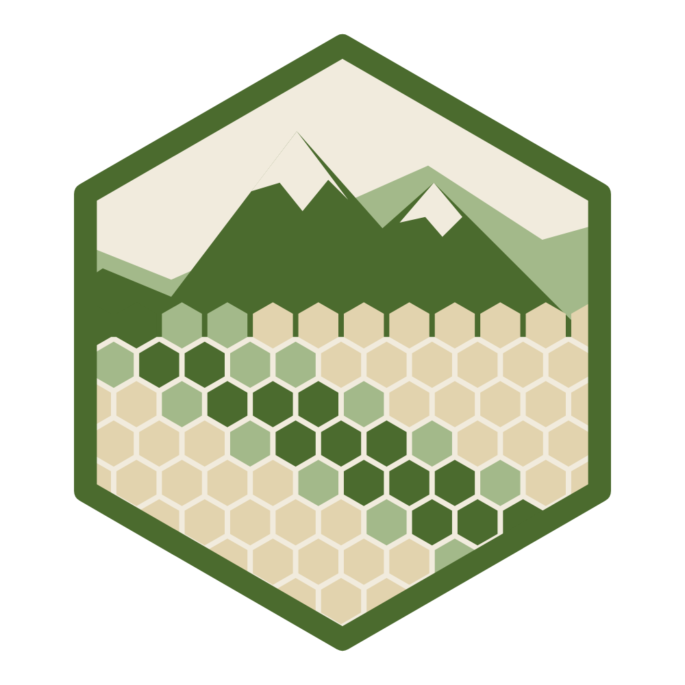
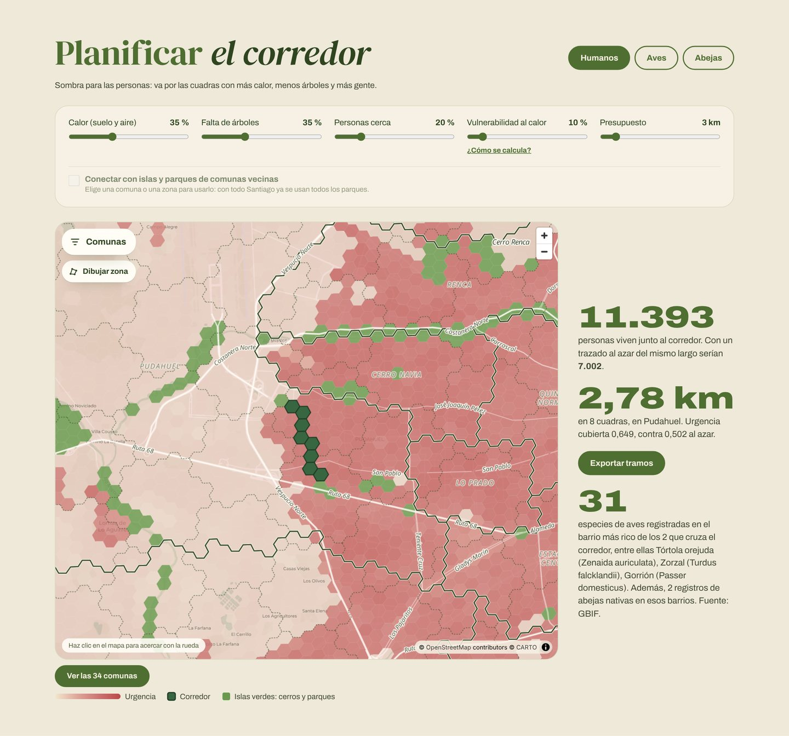

# Viridis



**Corredores verdes que conectan los cerros y parques de Santiago, cuadra por cuadra, para las personas, las aves
y las abejas.**

Demo: **https://viridis-w7yj.onrender.com** · Track: 🌎 Physical World · Platanus Hack 26 Santiago, team-26

[](https://github.com/platanus-hack/platanus-hack-26-cl-team-26/actions/workflows/tests.yml)



## Qué hace

Los cerros y parques de Santiago son islas: ahí viven aves y abejas, pero el cemento y el calor las separan, y
solo el 14 % de la gente vive a menos de 300 m de un espacio verde. Viridis divide las 34 comunas del Gran
Santiago en 13.172 cuadras (grilla H3), mide en cada una el calor, la copa de árboles, cuánta gente vive ahí y qué
tan vulnerable es al calor, y traza el corredor que une isla con isla donde más se necesita. Se elige para quién
(personas, aves, abejas o todas), dónde (comunas o una zona dibujada) y cuántos kilómetros. El corredor se
exporta en GeoJSON, listo para QGIS: qué plantar en cada cuadra (árboles o flores) y sus datos, con el criterio
usado y la comparación con un trazado al azar.

## Resultados

Con 3 km de presupuesto y los pesos por omisión, el corredor llega a más gente que un trazado al azar del mismo
largo (promedio de 200 caminatas al azar que parten junto a un parque):

| Dónde | Personas en las cuadras del corredor | Al azar | Diferencia |
|---|---|---|---|
| Providencia y Cerro Navia | 11.908 | 8.261 | +44 % |
| Las 34 comunas (el corredor cae en Pudahuel) | 11.393 | 7.002 | +63 % |

Y la gente que cubre el corredor de las 34 comunas es más vulnerable al calor que el promedio de Santiago (índice
0,52 contra 0,40, ponderado por personas).

Con 100 km de corredores para personas, aves y abejas («Santiago conectado»), 30 islas verdes dejan de estar
solas (4.055 ha de hábitat unido) y la gente a menos de 300 m de un espacio verde pasa de 862.801 (14 %) a
1.627.165 (26 % de Santiago).

Para reproducirlas, con los datos del repo y sin internet: `python -m verdeh3.contrato` escribe
`data/cifras_pitch.json` y `python red_conectada.py` escribe `web/public/data/red.json`. Los dos dejan los archivos
idénticos a los versionados. Las cifras no usan la temperatura del aire, que cambia cada día.

## Cómo funciona

```
Landsat, Sentinel-2, Censo 2024, OSM, GBIF ─► verdeh3/ (pipeline) ─► data/santiago_h3_gs.parquet (CONTRATO.md)
Estaciones DMC y SINCA ─► maximas.py, cada noche en GitHub Actions ─► data/live_h3.parquet
                                        │
                      optimizer.py + ecologia.py: urgencia y corredor
                                        │
                terreno/servidor.py (FastAPI) ─► web/ (Next.js exportado, MapLibre), un solo servicio
```

- **El corredor es un camino en un grafo.** Cada cuadra es un nodo: entrar cuesta 1 / (0,05 + urgencia) y los
  parques cuestan 0. Dijkstra da el camino más barato entre parques vecinos, y los tramos se unen en una sola red
  continua hasta llenar el presupuesto. Cada resultado se compara con corredores al azar del mismo largo.
- **Un criterio por especie.** Personas: urgencia (35 % calor, 35 % falta de árboles, 20 % personas y 10 %
  vulnerabilidad, todos ajustables). Aves: resistencia según copa, pasto y construido, para buscar copa
  continua. Abejas: mini islas floridas, una cuadra por medio, para que el presupuesto alcance el doble de
  distancia. Con varias especies se promedian.
- **Copa de árboles con un modelo propio** sobre Sentinel-2, entrenado con el mapa de altura de copa de Meta y
  WRI: r = 0,92 por cuadra en comunas que no vio al entrenar, contra 0,84 del mapa global de la ESA.
- **Términos comparables.** Cada uno va de 0 a 1 entre los percentiles 2 y 98, para que pocos extremos no
  aplasten al resto.
- **No inventamos datos.** El aire es la máxima de ayer de estaciones oficiales: entra solo en los barrios con dato
  confiable, y solo si son al menos 5. No prometemos grados de enfriamiento: no hay un coeficiente publicado que
  citar.

Cada decisión, con la alternativa que descartamos y su evidencia, está en [docs/decisiones.md](docs/decisiones.md).

## Cómo correrlo

```bash
docker build -t viridis . && docker run -p 8000:8000 viridis     # http://localhost:8000
```

Sin Docker:

```bash
pip install -r requirements.txt
cd web && npm ci && npm run exportar && cd ..
python -m terreno.servidor --puerto 8000
```

Tests: `python -m pytest -q`, más `python -m tests.test_contrato` (columnas, rangos y que el corredor sea
continuo) y `python -m tests.test_vulnerabilidad`. Para trabajar en la página con recarga en vivo, ver
[web/README.md](web/README.md).

## Estructura

| Dónde | Qué |
|---|---|
| `verdeh3/`, `ingesta/` | Pipeline de datos (`verdeh3` es el nombre interno, de cuando el proyecto se llamaba VerdeH3): grilla H3, satélites, modelo de copa, Censo, OSM ([docs/datos.md](docs/datos.md)) |
| `data/` | Lo que usa la app: las cuadras, el aire del día, la fauna |
| `datos/` | Intermedios del pipeline, versionados para poder regenerar todo sin internet |
| `optimizer.py`, `ecologia.py` | Urgencia y corredores |
| `maximas.py`, `interpolar.py`, `calidad.py`, `fuentes.py` | Máxima diaria del aire por barrio |
| `fauna_gbif.py`, `red_conectada.py` | Aves y abejas de GBIF, y la red de «Santiago conectado» |
| `terreno/` | El servidor (FastAPI): API y sitio |
| `web/` | El sitio (Next.js 16, MapLibre) |
| `tests/` | Tests (pytest) |

Las fuentes de cada dato están en la página [/fuentes](https://viridis-w7yj.onrender.com/fuentes/) y en
[CONTRATO.md](CONTRATO.md).

**Experimento retirado:** la captura en terreno desde el teléfono (fotos validadas con Claude y aves reconocidas
por su canto con BirdNET). Quitamos la página para enfocarnos en el sitio. Su API de subida (`/api/captura`,
`/api/video`, `/api/audio`) queda apagada; se activa con `python -m terreno.servidor --captura` (BirdNET va aparte:
`pip install -r requirements-captura.txt`), y sus tests siguen en `tests/test_terreno.py`.

## Equipo

- Antonio Cormatches Contreras ([@sopademangos](https://github.com/sopademangos))
- Benjamín Mauricio Alvarado Guerra ([@elvenji](https://github.com/elvenji))
- Ian Berdichewsky García ([@iaaaanb](https://github.com/iaaaanb))
- Emilia Isadora Cabrera Varas ([@nayru-dev](https://github.com/nayru-dev))
- Vicente Cepeda Carrasco ([@vicentepecera](https://github.com/vicentepecera))
